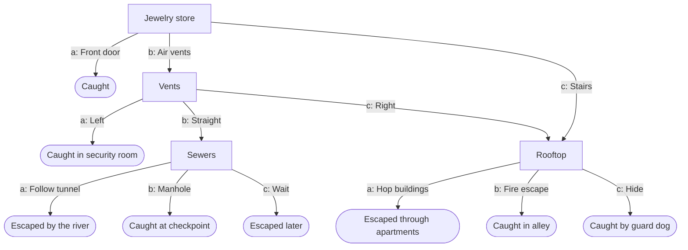

# Escape from the Jewelry Store

A choose-your-own-adventure game in Python, played in the terminal. You've just robbed a jewelry store, and every choice you make decides whether you escape or get caught. There are 8 endings to find.

Started as a class project at Stevens Institute of Technology and rebuilt as a personal project.

## How to play

Requires Python 3.8 or newer. No extra packages needed.

```
python game.py
```

Type `a`, `b`, or `c` at each choice. After each run, the game tells you how many of the 8 endings you've found.

## Story map



## How the code is organized

- The whole story lives in one dictionary, `STORY`. Each scene has text and either three choices (each pointing to the next scene) or an ending. This makes the story a graph.
- `play_once` walks through that graph based on the player's choices. It never needs to change when the story grows: new scenes are just new dictionary entries.
- `ask_for_choice` keeps asking until the player types a valid letter, so typos can't break the game.

## Tests

```
python -m unittest
```

The tests check the story itself, not just the gameplay: every choice points to a real scene, every scene can be reached from the start, and each scene has either choices or an ending.

## What I changed from the original assignment

- Fixed a bug where choosing the vents crashed the game
- Moved the story out of nested `if` statements into a data structure
- Expanded the story from 4 endings to 8
- Added input validation, an ending tracker, and play-again
- Added unit tests that check every path in the story
